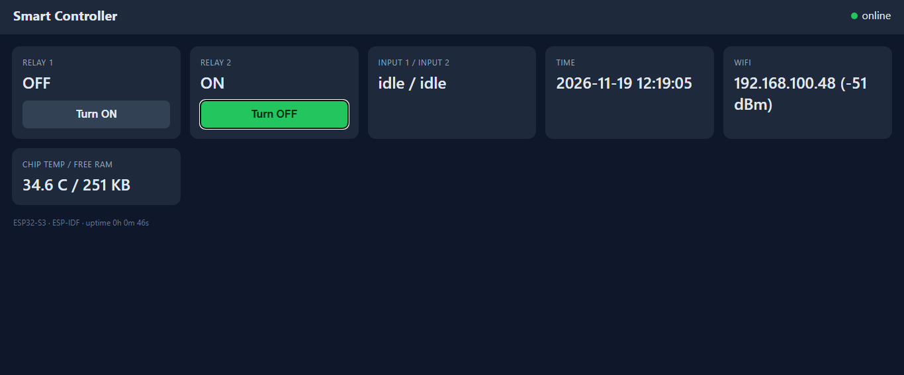

# Smart Controller: ESP32-S3 IoT Relay Controller

Firmware for an ESP32-S3 relay board (KinCony KC868-A2v3), written in **C++ on ESP-IDF 5.5 / FreeRTOS**.
The board hosts its own web dashboard and REST API, runs daily timers, reacts to physical inputs,
reports to an MQTT broker and updates itself over WiFi with automatic rollback.



## Features

| Area | What it does |
|---|---|
| **Web dashboard** | Served by the board itself (no cloud, no internet needed). Live status, relay buttons, timers, event log, settings |
| **REST API** | JSON endpoints for status, relays, schedules, WiFi, OTA and reboot |
| **Relays** | 2 relays. Last state is saved to flash and restored after a power cut |
| **Daily schedules** | ON/OFF time per relay, stored in NVS, driven by NTP time (Pakistan time, UTC+5) |
| **Local control** | Digital inputs act like wall push-buttons and toggle their relay (60 ms debounce) |
| **MQTT** | Publishes full status every 10 s and on every change; accepts commands from anywhere |
| **OTA update** | Upload a new `.bin` from the browser. Two app slots, SHA-256 check, **automatic rollback** if the new firmware does not come up healthy |
| **WiFi setup portal** | No WiFi saved, or WiFi unreachable for 30 s → board opens its own access point with a setup page |
| **OLED display** | Own SSD1306 I2C driver (no library): IP, relay states, MQTT, date and time |
| **Event log** | Last 20 events with timestamp and source (web / schedule / input / mqtt) |
| **Diagnostics** | Chip temperature, free RAM, WiFi RSSI, uptime, firmware version and active slot |

## Architecture

```
                 ┌──────────────── ESP32-S3 (FreeRTOS tasks) ─────────────────┐
 Browser ──HTTP──┤ web        dashboard + REST API ───┐                         │
 Phone  ──MQTT───┤ mqtt_link  status / cmd topics ────┤                         │
                 │ schedule   daily timers (NTP) ─────┼──► io ──► Relay 1 / 2   │
 Wall switch ────┤ io         input watcher ──────────┘     ▲                   │
                 │ ota        firmware upload + rollback    │ state saved (NVS) │
                 │ wifi       STA + setup AP fallback       storage             │
                 │ oled       SSD1306 over I2C              events (log)        │
                 └─────────────────────────────────────────────────────────────┘
```

| File | Responsibility |
|---|---|
| `main/main.cpp` | Start-up order, OLED task, health check for OTA |
| `main/config.hpp` | All settings (pins, AP password, MQTT broker, timezone) |
| `main/wifi.*` | Station mode, saved credentials, setup access point |
| `main/io.*` | Relays (persisted), inputs (debounced), chip temperature |
| `main/schedule.*` | Daily timers stored in NVS |
| `main/web.*` | HTTP server, dashboard page, REST API |
| `main/mqtt_link.*` | MQTT status publishing and remote commands |
| `main/ota.*` | Firmware upload, boot slot switch, rollback confirmation |
| `main/status.*` | One JSON snapshot shared by the web API and MQTT |
| `main/oled.*`, `font6x11.hpp` | SSD1306 driver and bitmap font |
| `main/storage.*`, `main/events.*` | NVS helpers, event ring buffer |
| `partitions.csv` | Two 3 MB OTA slots on 16 MB flash |

## REST API

| Method | Path | Description |
|---|---|---|
| GET | `/api/status` | Full device status (JSON) |
| GET | `/api/events` | Last 20 events |
| POST | `/api/relay?ch=1&on=1` | Switch relay 1 ON (`on=0` for OFF) |
| POST | `/api/schedule?ch=1&en=1&on=18:00&off=23:00` | Set the daily timer |
| POST | `/api/wifi` | Body `ssid=...&pass=...` → saves and reboots |
| POST | `/api/ota` | Body = firmware `.bin` → updates and reboots |
| POST | `/api/reboot` | Reboot |

Example status:
```json
{"id":"1B6774","version":"1.0.0","partition":"ota_0","ssid":"MyWiFi","ip":"192.168.1.48",
 "rssi":-51,"ap_mode":false,"mqtt":true,"time":"2026-11-19 18:00:05","uptime_s":3605,
 "free_heap":231000,"chip_temp_c":41.2,"relays":[true,false],"inputs":[false,false],
 "schedule":[{"enabled":true,"on":"18:00","off":"23:00"},{"enabled":false,"on":"18:00","off":"23:00"}]}
```

## MQTT

Broker: `broker.hivemq.com:1883` (public test broker, change it in `config.hpp`).

| Topic | Direction | Payload |
|---|---|---|
| `smartctl/<id>/status` | board → | Same JSON as `/api/status` (retained) |
| `smartctl/<id>/cmd` | → board | `1 on`, `1 off`, `2 toggle` |

Test from a PC: `mosquitto_sub -h broker.hivemq.com -t "smartctl/#" -v`
and `mosquitto_pub -h broker.hivemq.com -t smartctl/<id>/cmd -m "1 toggle"`.

> The public broker has no password, so anyone who knows the topic can read and send commands. That is fine for a demo. For real use, switch to a private broker with TLS and a username/password.

## Build and flash

Requires ESP-IDF v5.5.

```bash
cp main/secrets.h.example main/secrets.h   # optional: WiFi for first boot
idf.py set-target esp32s3
idf.py build
idf.py -p COM7 flash monitor
```

No `secrets.h`? The board starts in **setup mode**:
1. Join the WiFi `SmartCtl-XXXX` with password `smart1234`.
2. Open `http://192.168.4.1`.
3. Enter your WiFi under **Settings**.

### Update over WiFi (OTA)
1. Change `version.txt` (e.g. `1.0.1`), then run `idf.py build`.
2. On the dashboard, go to **Settings → Firmware update**, choose `build/smart_controller.bin` and click **Upload**.
3. The board reboots into the other slot. If it does not reach WiFi within 30 s, the next reboot returns to the previous firmware.

## Hardware

KinCony KC868-A2v3 (ESP32-S3-WROOM-1U N16R8):

| Function | Pins |
|---|---|
| Relays | GPIO40, GPIO39 |
| Digital inputs | GPIO16, GPIO17 (active low) |
| SSD1306 OLED | I2C on SDA 48 / SCL 47, address 0x3C |

No extra hardware is needed: just the board and a USB cable.

## Skills shown

ESP-IDF · FreeRTOS tasks and synchronisation · C++20 · WiFi STA/AP · HTTP server and REST design · MQTT · NTP · NVS persistence · OTA with rollback and custom partition table · I2C driver from datasheet · GPIO debouncing · HTML/CSS/JS front-end
